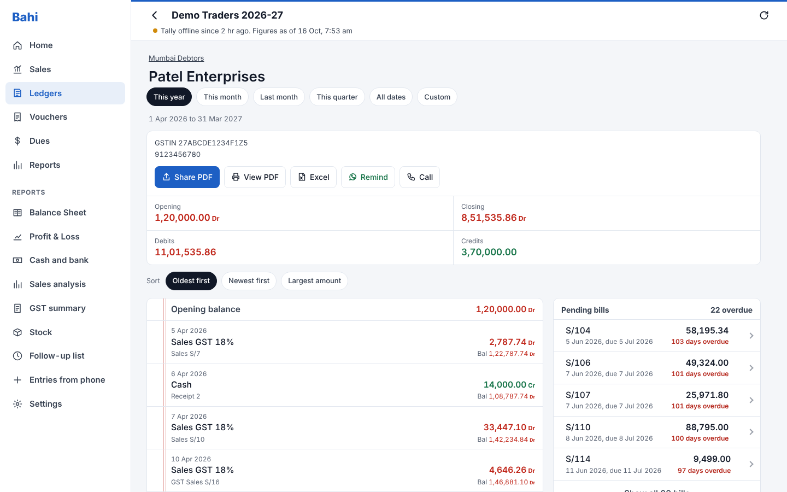
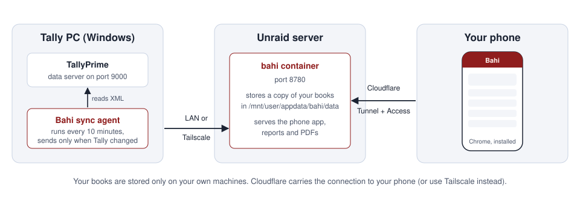

# Bahi: your TallyPrime books on your phone

Bahi is a free, self-hosted alternative to apps like Credflow and Livekeeping. A small agent on your Tally PC copies your books to your own server, and you open them on your phone. You can see ledgers, vouchers, bill-wise dues, stock, GST and reports, and share Tally-style PDFs on WhatsApp.

<table>
<tr>
<td></td>
<td></td>
<td></td>
<td></td>
</tr>
</table>

On a computer, Bahi switches to a wide layout with a menu down the left:

*Screenshots use made-up demo data.*

## What you get

- **Home dashboard:** what you will receive, what you owe, cash, bank, stock value, and monthly sales.
- **Sales by day:** daily sales or purchases with bills, tax, returns and month totals. Tap a day to see its bills.
- **Ledgers:** sort by name, balance or recent activity. Search any ledger and see the full statement with running balance. Call, WhatsApp, or share a PDF.
- **Vouchers:** search by party, voucher number, amount or narration. Open any voucher as an invoice with items, GST, bill references and narration.
- **Dues:** bill-wise receivables and payables with ageing (0-30, 31-60, 61-90 and 90+ days), overdue amounts, and WhatsApp payment reminders that list the overdue bills.
- **Stock:** quantity, rate and value of every item, plus item movements.
- **Balance Sheet and Profit & Loss in Tally's own layout**, and a **cash and bank book** with daily opening and closing balances.
- **Follow-up list:** overdue and due-this-week customers, with your notes and promised payment dates.
- **Sales analysis:** customers and items against last year, item margins, month by month this year against last, and slow-moving stock.
- **Excel downloads** of ledgers, vouchers, dues and analysis.
- **Telegram:** a morning summary of yesterday's business and an alert when a large payment comes in.
- **Reports:** Day Book, Profit & Loss, GST summary (output tax, input credit and net payable by month), and a group summary.
- **PDFs like TallyPrime prints:** Tax Invoice, Receipt/Payment/Journal voucher, and Ledger Account.
- **Enter receipts, payments and sales orders on the phone.** They go into Tally at the next sync.
- **Staff logins** that show each person only what you allow, with your approval for their entries.
- **Sync your way:** automatic every few minutes, manual with a **Sync now** button, or paused.
- **Nightly backups** on your server, the last 7 kept.
- **Works offline:** your phone keeps the last data you opened.
- **Private:** your data lives on your own server. The app needs a password, and you can put Cloudflare Access in front of it.

## How it works

1. TallyPrime's built-in data server (port 9000) lets programs on the same PC read your books.
2. The **sync agent** (PowerShell, no install needed) runs every 10 minutes. When something has changed in Tally, it sends only the months that changed, plus masters and outstanding bills. It also adds entries made on the phone into Tally.
3. The **Bahi server** (one Docker container) stores the data and serves the phone app.
4. Your **phone** opens the app in Chrome and installs it to the home screen like a normal app.

## Get started

- **[Installation guide](docs/INSTALL.md):** set up Tally, Unraid, the Tally PC and your phone, step by step.
- **[User guide](docs/USING.md):** what every screen does.
- **[Troubleshooting](docs/INSTALL.md#troubleshooting)**

## Repository layout

| Folder | What's inside |
|---|---|
| `server/` | The Docker app. Python standard library only, no extra packages. |
| `agent/` | Sync agent for the Windows PC that runs TallyPrime. |
| `tests/mock_tally.py` | A simulated Tally server used for testing without real books. |
| `docs/` | Guides and screenshots. |

`unraid/bahi.xml` is an Unraid Docker template you can add by hand (see the installation guide). Bahi is not listed in Community Apps.

The Docker image is built automatically on every change and published as `ghcr.io/bdlnaredi/bahi:latest`.

## License

Copyright (C) 2026 bdlnaredi

Bahi is free software: you can redistribute it and/or modify it under the terms of the
[GNU General Public License version 3](LICENSE) or any later version. If you share a changed
version, you must share its source code under the same license. Bahi comes with no warranty.

Bahi is not affiliated with or endorsed by Tally Solutions. TallyPrime is a trademark of its owner.
