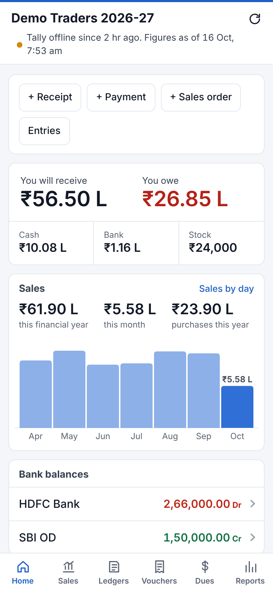
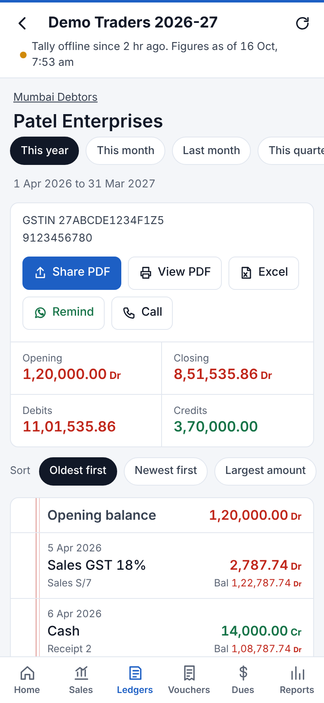
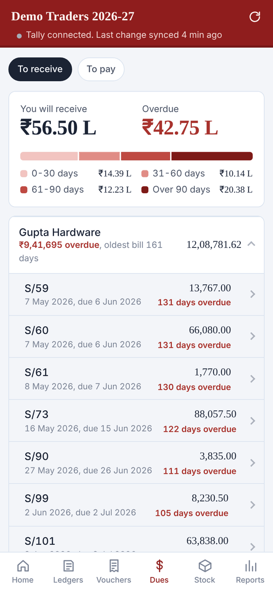
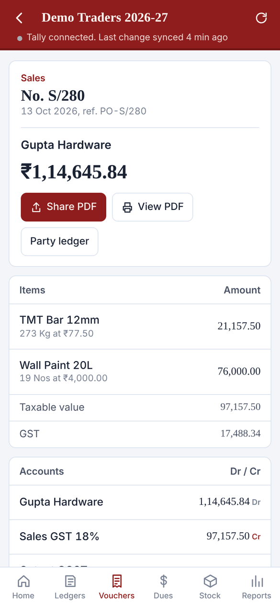
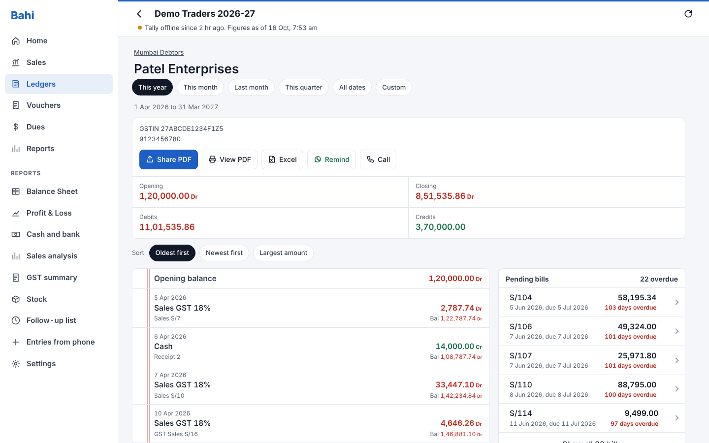
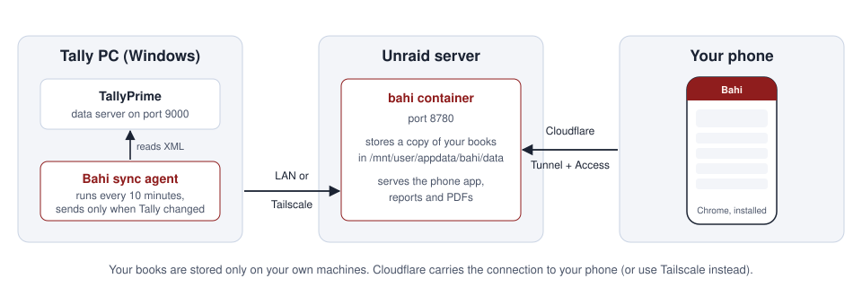

# Bahi: your TallyPrime books on your phone

Bahi is a free, self-hosted alternative to apps like Credflow and Livekeeping. **Bahi Sync** on your Tally PC copies your books to your own server, such as Unraid. You then open them in the Android app or in a browser on any phone or computer.

You can:
- see ledgers, vouchers, bill-wise dues, stock, GST and reports;
- share Tally-style PDFs on WhatsApp;
- send customers their own ledger link and a UPI payment request;
- enter receipts, payments, orders, sales, purchases and new stock items from the phone.

Bahi never deletes or changes anything in Tally.

<table>
<tr>
<td></td>
<td></td>
<td></td>
<td></td>
</tr>
</table>

On a computer, Bahi switches to a wide layout with a menu down the left:

*Screenshots use made-up demo data.*

## Install

1. **Server:** on Unraid, open the **Apps** tab, search for **bahi** and click **Install**. Set an app password and a sync token. Any other Docker host works too: see the [installation guide](docs/INSTALL.md#option-b-docker-compose-compose-manager-plugin).
2. **Tally PC:** run [BahiSync-Setup.exe](https://github.com/bdlnaredi/bahi/releases/download/windows/BahiSync-Setup.exe), then enter the server address and the sync token. Turn on Tally's data server (port 9000) first.
3. **Phone:** install [Bahi.apk](https://github.com/bdlnaredi/bahi/releases/download/android/Bahi.apk), or open the server address in Chrome and add it to the home screen.

To reach Bahi away from home, use Cloudflare Tunnel or Tailscale. The **[installation guide](docs/INSTALL.md)** goes through every step, and the **[user guide](docs/USING.md)** explains each screen.

## What you get

### Your books
- **Home:** what you'll receive, what you owe, cash, bank, stock value and sales at a glance.
- **Sales by day, week or month:** the steps follow the period you pick. Tap a day to see its bills.
- **Ledgers:** sort by name, balance or recent activity, and open any statement with its running balance. Call, WhatsApp or share a PDF from there.
- **Vouchers:** search by party, number, amount or narration. Each opens as an invoice with items, GST, bill references and narration.
- **Dues:** bill-wise receivables and payables with ageing (0-30, 31-60, 61-90 and 90+ days), plus interest on overdue bills.
- **Follow-up list:** overdue customers, with your notes and promised payment dates.
- **Stock:** quantity, rate and value, item movements for any period, and stock by godown.
- **Reports:**
  - Balance Sheet and Profit & Loss in Tally's own layout;
  - Day Book;
  - GST summary (output tax, input credit and net payable by month);
  - group summary;
  - cash and bank book.
- **Bank reconciliation:** upload a bank statement (Excel or CSV) to see what matches, what the bank hasn't shown yet, and what's missing in Tally.
- **Sales analysis:** customers and items against last year, item margins, and slow-moving stock.
- **Excel downloads** of ledgers, vouchers, dues and analysis.
- **Several companies:** every company open in Tally. Tap the company name to switch.

### Sharing with customers
- **PDFs like TallyPrime prints:**
  - Tax Invoice, with the full invoice number, the GST summary exactly as Tally has it, the e-invoice QR and an e-way bill page;
  - Receipt, Payment and Journal vouchers;
  - Ledger Account.
- **Customer links:** each party gets a private page with their balance, pending bills, statement and invoices. The link is added whenever you share with them.
- **UPI payment requests:** a link or QR code that opens the customer's UPI app with the amount filled in. Invoices print a pay QR code too. The money goes straight to your bank.
- **WhatsApp payment reminders** that list the overdue bills.
- **Telegram:**
  - a morning summary;
  - alerts for large payments and low stock;
  - ledger lookups: send the bot a party's name, spelt any way.

### Entries from the phone
- **Receipts, payments, journals, contras, sales orders, sales invoices and purchases.** They go into Tally at the next sync.
- **New stock items:** name, group, unit, HSN, GST rate and barcode.
- **Barcodes:** scan to give items their barcodes, then scan items straight into a bill. Each scan beeps.
- **Staff logins:** each person sees only what you allow, and their entries wait for your approval.

### Running it
- **Bahi Sync for Windows** sits in the tray on the Tally PC. It shows status, log and **Sync now**, starts with Windows, and keeps itself up to date. Syncing can be automatic, manual or paused.
- **Two servers at once:** for example Unraid and a cloud server.
- **Nightly backups** on the server, also copied to your **Google Drive or OneDrive** if you connect one. Restore any of them from the app.
- **Android app** with a full **offline copy** of your books, which updates itself from inside the app.
- Hindi text works in PDFs. Dark mode follows your phone.

## Safe for your Tally data

- **Syncing only reads.** The only things Bahi ever puts into Tally are entries you made in the app. They go in as **new vouchers** or **new stock items**, never as changes.
- **Checked twice:** the server and the Tally PC both check every request before it reaches Tally, and anything else is blocked.
- **Exact figures:** balances, GST and stock are shown exactly as Tally has them. Bahi doesn't recalculate them.
- **Private:** your data stays on your own server, behind a password. You can put Cloudflare Access in front of it.

## How it works

1. TallyPrime's built-in data server (port 9000) lets programs on the same PC read your books.
2. **Bahi Sync** checks Tally every 2 minutes and sends only what changed: changed vouchers, masters and outstanding bills. It also adds the entries made in the app.
3. The **Bahi server** is one Docker container, written in Python with nothing else to install. It stores the data and serves the app.
4. Your **phone** uses the Android app or the web app, which you can install from Chrome.

## Updating

- **Server:** Unraid shows *update ready* on the container. Click it. Your data is kept.
- **Tally PC:** updates itself after the server updates.
- **Android app:** offers each new version when you open it.

See the **[changelog](CHANGELOG.md)** for what changed in each version.

## Repository layout

| Folder | What's inside |
|---|---|
| `server/` | The Docker app, using the Python standard library plus Pillow for Hindi text in PDFs. |
| `agent/` | The sync on the Tally PC (PowerShell). It updates itself from the server. |
| `windows/` | Bahi Sync for Windows and its installer. |
| `android/` | The Android app. |
| `unraid/` | The Unraid template. It is also listed in Community Apps. |
| `tests/mock_tally.py` | A pretend Tally server for testing without real books. |
| `docs/` | Guides and screenshots. |

GitHub builds every change automatically:
- the Docker image `ghcr.io/bdlnaredi/bahi:latest`;
- `BahiSync-Setup.exe`;
- `Bahi.apk`.

## Help

Open an [issue on GitHub](https://github.com/bdlnaredi/bahi/issues). For sync problems, attach the report from Bahi Sync → **Tools** → **Diagnose**. Look through it first and remove anything you don't want to share.

## License

Copyright (C) 2026 bdlnaredi

Bahi is free software: you can redistribute it and/or modify it under the terms of the
[GNU General Public License version 3](LICENSE) or any later version. If you share a changed
version, you must share its source code under the same license. Bahi comes with no warranty.

Bahi is not affiliated with or endorsed by Tally Solutions. TallyPrime is a trademark of its owner.
