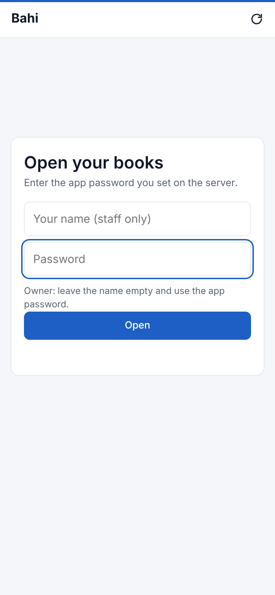
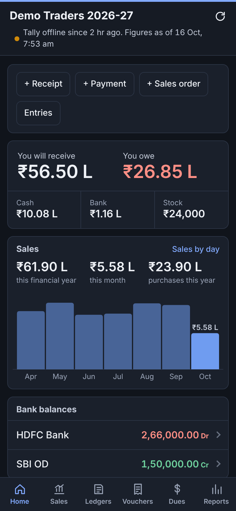

# Installation guide

Setting up Bahi takes about 20 minutes. You need:

| What | Why |
|---|---|
| A Windows PC with **TallyPrime** | Bahi reads your books from here |
| An **Unraid** server (or any machine with Docker) | Stores the data and runs the app |
| **Tailscale** on the Tally PC and Unraid, *or* both on the same network | Lets the Tally PC reach the server |
| **Cloudflare Tunnel** (or Tailscale on your phone) | Lets your phone reach the server from anywhere |
| An Android phone with Chrome | To use the app |

The steps, in order:

1. [Turn on Tally's data server](#1-turn-on-tallys-data-server)
2. [Make two secrets](#2-make-two-secrets)
3. [Install the server on Unraid](#3-install-the-server-on-unraid)
4. [Install the sync agent on the Tally PC](#4-install-the-sync-agent-on-the-tally-pc)
5. [Reach the app from your phone](#5-reach-the-app-from-your-phone)
6. [Install the app on your phone](#6-install-the-app-on-your-phone)

---

## 1. Turn on Tally's data server

This setting lets programs on the same PC read your company data. Nothing is opened to the internet.

1. Open **TallyPrime**.
2. Press **F1 (Help)**, then go to **Settings → Connectivity → Client/Server configuration**.
3. Set:
   - **TallyPrime is acting as**: `Both`
   - **Enable ODBC**: `Yes`
   - **Port**: `9000`
4. Accept the screen with **Ctrl + A**, then **restart TallyPrime** and open your company.

> **Check it worked:** on the Tally PC, open Chrome and go to `http://localhost:9000`. You should see a short message such as `<RESPONSE>TallyPrime Server is Running</RESPONSE>`.

## 2. Make two secrets

Bahi uses two passwords:

| Secret | Used by | Tip |
|---|---|---|
| **App password** | You, when you open the app on your phone | Something you can type on a phone, at least 10 characters |
| **Sync token** | The Tally PC agent, to send data to the server | Long and random. You only type it once. |

To make a random sync token, open the Unraid terminal (the `>_` icon at the top right of the Unraid web page) and run:

```
openssl rand -hex 24
```

Keep both secrets somewhere safe, such as a password manager.

## 3. Install the server on Unraid

### Option A: Unraid template (recommended, one-click updates)

Bahi isn't listed in Community Apps, so add its template by hand once:

1. Open the Unraid terminal (`>_`) and run this to download the template:
   ```
   wget -O /boot/config/plugins/dockerMan/templates-user/my-bahi.xml https://raw.githubusercontent.com/bdlnaredi/bahi/main/unraid/bahi.xml
   ```
2. Go to the **Docker** tab and click **Add Container**.
3. In the **Template** dropdown, choose **bahi** (under *User templates*).
4. Fill in:
   - **App password**: your app password from step 2
   - **Sync token**: your sync token from step 2
   - Leave **Web UI port** as `8780` and **Data** as `/mnt/user/appdata/bahi/data`.
5. Click **Apply**. Unraid downloads the image and starts the container.
6. From any computer at home, open `http://UNRAID-IP:8780`, using your Unraid server's IP address. You should see the **Open your books** login page.



**Updates:** when a new version is published, the Docker tab shows *update ready* on the bahi container. Click it to update. Your data is kept.

### Option B: Docker Compose (Compose Manager plugin)

Use this if you prefer stacks. Paste this into **Docker → Compose → Add New Stack** (name it `bahi`), put in your secrets, then click **Compose Up**:

```yaml
services:
  bahi:
    image: ghcr.io/bdlnaredi/bahi:latest
    container_name: bahi
    restart: unless-stopped
    ports:
      - "8780:8780"
    environment:
      - APP_PASSWORD=your-app-password
      - SYNC_TOKEN=your-sync-token
    volumes:
      - /mnt/user/appdata/bahi/data:/data
```

To update: **Compose Pull**, then **Compose Up**.

> Don't run Option A and Option B at the same time. Both use port 8780.

## 4. Install the sync agent on the Tally PC

### Bahi Sync app (recommended)

1. On the Tally PC, download **[BahiSync-Setup.exe](https://github.com/bdlnaredi/bahi/releases/download/windows/BahiSync-Setup.exe)** and run it. Windows may show *Windows protected your PC*: click **More info → Run anyway** (the app isn't signed with a paid certificate), then **Yes** to let it install.
2. It installs into `C:\Program Files\Bahi Sync` with everything it needs, adds **Bahi Sync** to the Start menu (and the desktop if you tick it) and an uninstaller (Windows Settings → Apps). If you used `BahiSync.exe` or the batch files before, close nothing: the installer stops the old copy, and the installed one brings your settings and sync records over from that folder, starts with Windows in its place, and says so in its log. The old folder can then be deleted.
3. The first time (on a new PC), it asks for the **Bahi server address** and the **sync token** (`SYNC_TOKEN` from Unraid). Tally's address and the sync start date can stay as they are. Click **Test connection**, then **Save**.

Bahi Sync then sits in the system tray (bottom-right of the taskbar), starts with Windows, and checks Tally every 2 minutes. Its window shows whether Tally and the server can be reached, the last sync and the log, with **Sync now**, **Pause**, **Settings**, **Companies** and **Tools** (Diagnose, Save a voucher or stock figures for a problem report, a full resend, open the log or folder). Closing the window keeps it syncing; to stop, right-click the tray icon → **Exit**.

It replaces the batch files and the Windows scheduled task (it removes the old task itself). The sync files keep updating themselves from your server, and the app offers its own new versions in the window. Prefer not to install? [BahiSync.exe](https://github.com/bdlnaredi/bahi/releases/download/windows/BahiSync.exe) is the same app on its own: put it in a folder such as `C:\Bahi` and run it from there.

#### More than one company

Every company open in TallyPrime is synced, and each one is its own company in the Bahi app: tap the company name at the top of the app to switch. **Companies** in Bahi Sync lists the companies it has seen in Tally: untick one to leave it out, or give one its own start date (an older year's company from 2023, say). Tally only lets Bahi read companies that are open in it, so open all of them together (**Alt+F3 → Select Company**, pick each one) or let TallyPrime open them when it starts (**F1 → Settings → Startup**). A company that isn't open keeps what it last synced and catches up when it is opened again.

### Or: the batch-file setup


1. On the Tally PC, download **[the agent folder](https://github.com/bdlnaredi/bahi/tree/main/agent)**. The easiest way is **Code → Download ZIP** on the repository's main page, then copy the `agent` folder out of the zip.
2. Put the files in a permanent folder, for example `C:\Bahi`. Don't run them from Downloads. The folder should contain:
   ```
   C:\Bahi\Setup.bat
   C:\Bahi\Setup-TallySync.ps1
   C:\Bahi\TallySync.ps1
   C:\Bahi\Sync-Now.bat
   C:\Bahi\run-hidden.vbs
   ```
3. Open **TallyPrime** with your company loaded.
4. Double-click **Setup.bat**. If Windows shows a blue *Windows protected your PC* box, click **More info → Run anyway**.
5. Answer the three questions:

   | Question | What to type |
   |---|---|
   | **Server address** | `http://UNRAID-IP:8780`. Use the Unraid LAN IP if the Tally PC is in the same building, otherwise the Unraid **Tailscale** IP (starts with `100.`) |
   | **Sync token** | The sync token from step 2 |
   | **Sync vouchers from date** | Press Enter for the current financial year, or type a date like `2024-04-01` to include earlier years |

6. Setup checks the server, runs the **first full sync** while you watch, and schedules an automatic sync every 10 minutes. A successful run ends like this:
   ```
   Server reachable and token accepted.
   Running the first full sync (keep TallyPrime open) ...
   Syncing ABC Traders (2026-04-01 to 2027-03-31) ...
   Done: 659 ledgers, 12 stock items, 4120 vouchers in 38.2 s
   Done. Tally data will sync every 10 minutes while this PC is on and Tally is open.
   ```

**Day-to-day:** nothing to do. While the PC is on and TallyPrime is open, changes reach the server within 10 minutes. You can change how often, or switch to manual or paused, in the app (**Reports → Settings**). Syncs run silently in the background and only send data when something changed in Tally.

| File | Use |
|---|---|
| `Sync-Now.bat` | Send everything right now, e.g. after a big data entry |
| `Pause-Sync.bat` / `Resume-Sync.bat` | Stop or restart the automatic sync on this PC. You can also choose automatic, manual or paused in the app's Settings. |
| `TallySync.log` | What each sync did, and any warnings |
| `Setup.bat` | Change the server address, token or from-date |
| `Diagnose.bat` | Writes a short report of voucher counts, for checking a sync problem |
| `Save-Voucher.bat` | Saves everything Tally has for one voucher into `voucher-sample.xml`, if asked for it to check a problem |
| `Save-Stock.bat` | Saves Tally's stock figures for a date into `stock-sample.xml`, if asked for it to check a stock problem |

You only copy these files once. After that the Tally PC updates them itself whenever the server is updated.

## 5. Reach the app from your phone

### Cloudflare Tunnel (recommended)

This gives you an `https://` address that works anywhere, without a VPN app.

1. In the **Cloudflare dashboard**, open **Zero Trust → Networks → Tunnels** and pick the tunnel you already use for Unraid.
2. Under **Public Hostname**, click **Add a public hostname**:
   - **Subdomain**: e.g. `books`
   - **Domain**: your domain
   - **Service**: `HTTP`, URL `UNRAID-IP:8780`
3. **Protect it with Cloudflare Access** (strongly recommended, because these are your accounts):
   - **Zero Trust → Access → Applications → Add an application → Self-hosted**
   - **Application domain**: `books.yourdomain.com`
   - Add a policy: **Action** `Allow`, **Include** `Emails`, and enter your own email address.
   - Save. Cloudflare will now email you a one-time code before the Bahi login page appears.

### Or: Tailscale on the phone

Install Tailscale on your phone and open `http://UNRAID-TAILSCALE-IP:8780`. You can install the app from that address too. Note that Chrome only offers a full install on `https://` addresses, so Cloudflare gives the nicer result.

## 6. Install the app on your phone

### Android app (recommended)

1. On the phone, open **https://github.com/bdlnaredi/bahi/releases/download/android/Bahi.apk** in Chrome. It downloads `Bahi.apk`.
2. Tap the download and **Install**. The first time, Android asks to allow installing from Chrome: tap **Settings → Allow from this source**, go back and tap **Install**.
3. Open **Bahi**, type your server address (`https://books.yourdomain.com`) and tap **Connect**. Pass the Cloudflare email code if asked, then enter your **app password**.

The app keeps an **offline copy** of everything (see Settings → Offline copy), opens PDFs and Excel files in your phone's apps, and shares invoices and ledgers straight to WhatsApp. When a new version is out, it offers to download it; install it over the old one and your login and saved data stay.

Use the `https://` address: the offline copy needs it.

### Or: add the web app to the home screen

1. Open your Bahi address in **Chrome** on the phone, e.g. `https://books.yourdomain.com`.
2. Pass the Cloudflare email code if asked, then enter your **app password** and tap **Open**.
3. Tap **⋮ → Add to Home screen → Install**.

The **Bahi** icon now opens the app full screen. You stay logged in for 30 days.

<table><tr>
<td></td>
<td></td>
</tr></table>

Continue with the **[user guide](USING.md)**.

---

## Updating

| Part | How |
|---|---|
| **Server** | Unraid Docker tab → **update ready** → click it. On Compose: **Compose Pull**, then **Compose Up**. |
| **Phone app** | The web app updates itself the next time you open it while online. The Android app offers new versions when you open it: tap **Download**, then install. Check **Reports → Sync** for the version number. |
| **Tally PC agent** | Download the latest `agent` folder and copy the files into `C:\Bahi`, replacing the old ones. Your settings are kept. Then run `Sync-Now.bat` once. |

When an update changes how data is stored, the server clears its copy and the next sync refills it automatically.

## Troubleshooting

| What you see | What to do |
|---|---|
| Setup says **Could not reach the server** | Check the address and port `8780`. Make sure the Tally PC can reach Unraid: same network, or Tailscale connected on both. Open `http://UNRAID-IP:8780` in Chrome on the Tally PC to test. |
| **(401) Unauthorized** in `TallySync.log` | The sync token on the PC doesn't match the server. Run `Setup.bat` again and enter the token exactly as set on Unraid. |
| **Tally is not reachable on http://localhost:9000** | TallyPrime isn't open, or step 1 wasn't saved. Restart Tally after changing the setting. |
| **Tally is open but no company is loaded** | Open your company in TallyPrime. |
| **The server refused … details** | The Unraid server is older than the agent. Update the server, then run `Sync-Now.bat`. |
| **Could not read … from Tally** | That optional detail (company address, bills report and so on) isn't available in your Tally release. Everything else still syncs. Open an issue with the log line. |
| **N vouchers did not balance** | Some voucher type is stored differently in your Tally. Open an issue with the voucher type and number. |
| Status line says **Tally offline since …** | The Tally PC is off or Tally is closed. The app shows the figures from the last sync. |
| The phone shows an old version | In Chrome: **⋮ → Settings → Site settings → All sites → your Bahi address → Clear & reset**, then log in again. |
| Unraid says **unauthorized** or **manifest unknown** when installing | The image isn't public yet. On GitHub: **Packages → bahi → Package settings → Change visibility → Public**. |

## Restoring a backup

Bahi backs up every night into `/mnt/user/appdata/bahi/data/backups`. To go back to one, open **Reports → Settings → Backups** in the app and tap **Restore** next to it, or choose a downloaded backup under **Restore from a backup file**. Bahi saves the current state first, so a restore can be undone the same way.

If the app itself won't start, do it by hand: stop the bahi container, copy everything inside the backup `.zip` into `/mnt/user/appdata/bahi/data` (replacing the files there), start the container, then run `Sync-Now.bat` on the Tally PC.

You can change the backup time with the `BACKUP_TIME` variable, e.g. `BACKUP_TIME=23:30`.

## Security notes

- The app password protects the phone app. The sync token protects the upload from the Tally PC. Use different, long values for each.
- Cloudflare Access adds a login before anyone reaches Bahi at all. Use it if the app is reachable from the internet.
- The agent reads from Tally. The only thing it ever writes into Tally is an entry made in the app (receipt, payment or sales order) that you or an approved staff member saved. It never changes or deletes an existing voucher.
- Staff passwords are stored hashed in `users.json` in the data folder.
- To start fresh, stop the container, delete `/mnt/user/appdata/bahi/data`, start it again, and run `Sync-Now.bat`.
