# User guide

All screenshots use made-up demo data.

The bar at the bottom has six sections: **Home, Sales, Ledgers, Vouchers, Dues and Reports**. Stock is under **Reports** and on the Home screen's Stock tile. The red bar at the top shows your company name, plus a line telling you when data was last synced and whether Tally is connected right now.

- **Tap the company name** to switch company, if you sync more than one.
- **Tap ↻** to reload the figures.
- **The period buttons** (This year, This month, Last month, This quarter, All dates, Custom) appear on most screens and decide which dates are shown. The app remembers your choice.

---

## Look and layout

- The app always opens in the **light** theme, whatever your phone's dark-mode setting. To use dark, tap **Switch light/dark** at the bottom of **Reports**.
- Amounts marked **Dr** are red and **Cr** are green.
- On a **phone** the sections are tabs along the bottom. Even if Chrome's *Desktop site* is switched on, Bahi shows its phone layout.
- On a **computer** the sections, and the main reports, are in a menu down the left. Home shows its cards in two columns, and a ledger shows the statement with pending bills beside it.

## Home

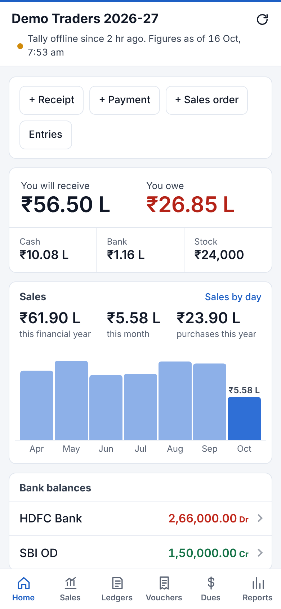

- **You will receive / You owe:** total of Sundry Debtors and Sundry Creditors. Tap either to open Dues.
- **Cash, Bank, Stock:** current balances. Tap to see the ledgers behind them.
- **Sales:** sales this financial year, this month, and purchases, with a bar for each month. Tap a bar to see the exact figure.
- **Bank balances**, **Biggest dues** and **Latest entries:** tap any row to open it.

 

## Sales by day

<table><tr>
<td>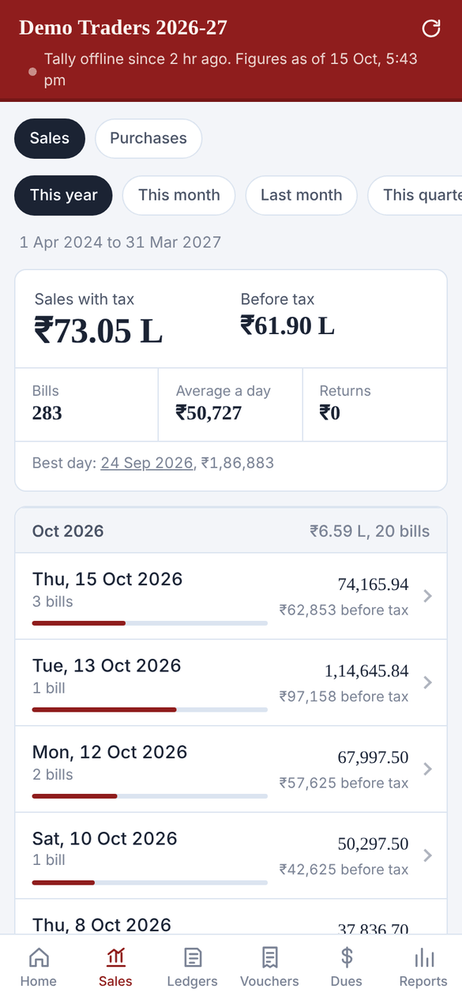</td>
<td>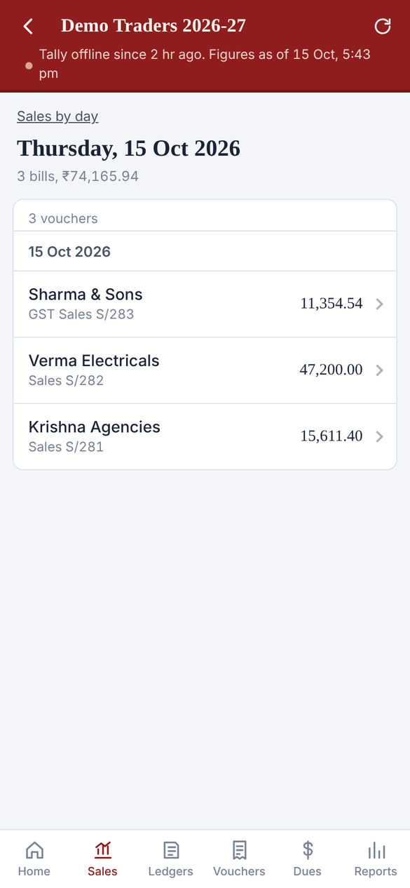</td>
</tr></table>

- Switch between **Sales** and **Purchases**, and pick the period.
- The top shows the total with tax and before tax, number of bills, average per day, returns (credit notes) and the best day.
- Below, every day is listed newest first, grouped by month with month totals. The red bar shows how the day compares with the busiest day.
- **Tap a day** to see that day's bills (and any returns). Tap a bill to open it.

## Ledgers

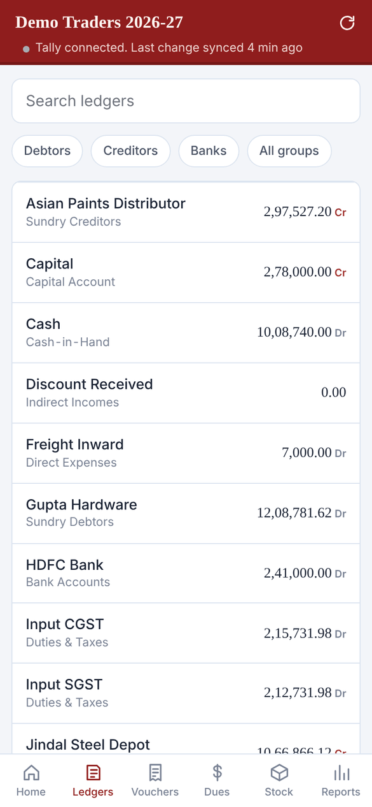

Type in the search box to find any ledger. The chips below the search box jump straight to **Debtors**, **Creditors**, **Banks** or **All groups**. **Sort** the list by name, by balance (largest first) or by most recent activity. The app remembers your choice.

 

### A party's ledger

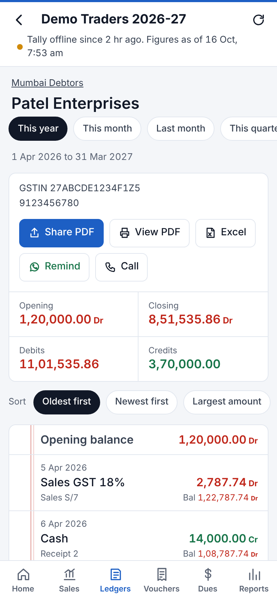

A ledger opens on **this month**, starting from the opening balance on the 1st. Tap another period (This year, Last month, Custom…) to see more. Your choice stays while you go from ledger to ledger, and goes back to this month the next time you open the app. The PDF and Excel follow the period on screen.

- The top shows phone, GSTIN, and **Opening, Closing, Debits and Credits** for the selected period.
- **Share PDF** sends a Tally-style *Ledger Account* PDF, e.g. to the party on WhatsApp. **View PDF** opens it on the phone.
- **Remind** opens WhatsApp with a ready-made payment reminder. It only appears for parties who owe you and have a mobile number in Tally.
- **Pending bills** lists unpaid bills with days overdue. Tap a bill to open its invoice.
- **Sort** the statement oldest first, newest first or by largest amount.
- The statement below is laid out like a ruled account book: each entry shows the other ledger, voucher type and number, amount (Dr or Cr) and the running balance. Tap an entry to open the voucher.

The closing balance always matches Tally, because running balances are worked back from Tally's own closing figure.

 

## Vouchers

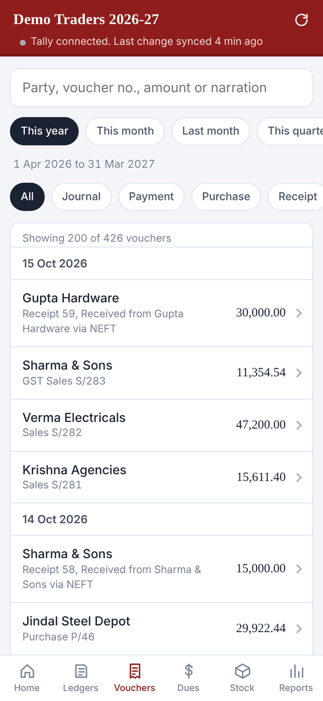

- **Search** by party name, voucher number (e.g. `S/279`), exact amount (e.g. `66080`) or a word from the narration.
- Filter by **voucher type** (Sales, Receipt, Payment and so on) and **period**. Use **All dates** to search everything synced.
- The count at the top shows how many vouchers matched. **Load more** at the bottom shows the next 200.
- **Cancelled** and **optional** vouchers are listed too, with a grey label and the amount struck through. They are never added into balances, totals or reports, just as in Tally.
- **Excel** at the bottom downloads the vouchers that matched, as a file Excel or Google Sheets opens.

 

**Your own voucher types.** Tally lets you make several types under one heading, for example *GST Sales* and *Counter Sales* under Sales, or *Bank Receipt* under Receipt. Bahi follows Tally: each one counts under its heading everywhere (totals, Sales by day, Profit & Loss, dues, analysis). To see just one, tap the heading (e.g. **Sales**), then pick the type in the second row. **All combined** goes back to everything. The same row appears in the Day Book and in Sales by day. **Reports → Sync check** lists each of your types and which heading it counts under.

### Opening a voucher

<table><tr>
<td>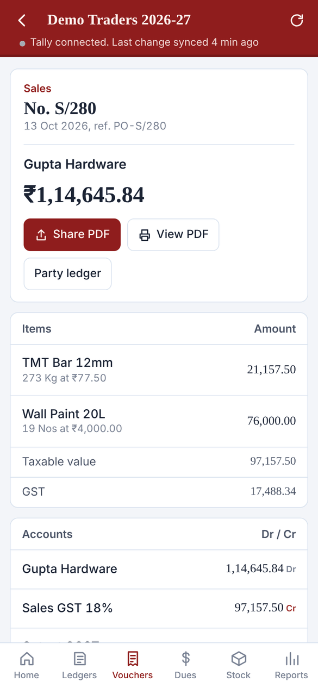</td>
<td>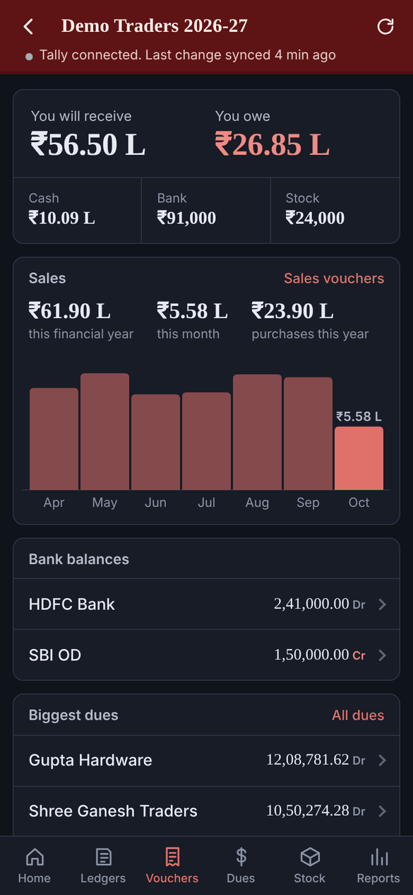</td>
</tr></table>

A voucher shows:

- the type, number, date and reference;
- the party and their GSTIN;
- the items with quantity and rate, plus taxable value and GST;
- every account with its Dr or Cr amount;
- bill references, such as which invoices a receipt settled (tap one to open that invoice);
- the narration.

**Share PDF** and **View PDF** produce the voucher in TallyPrime's print layout:

<table><tr>
<td>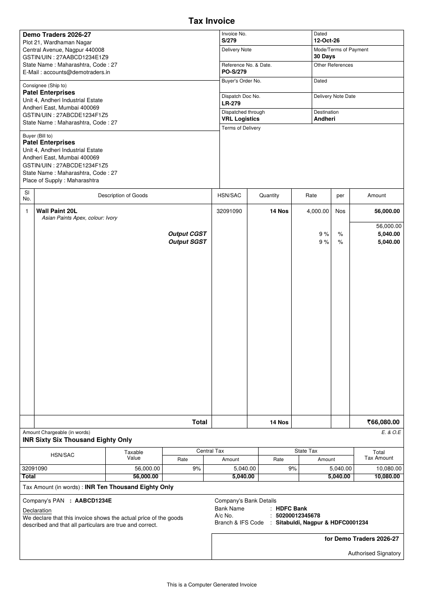</td>
<td>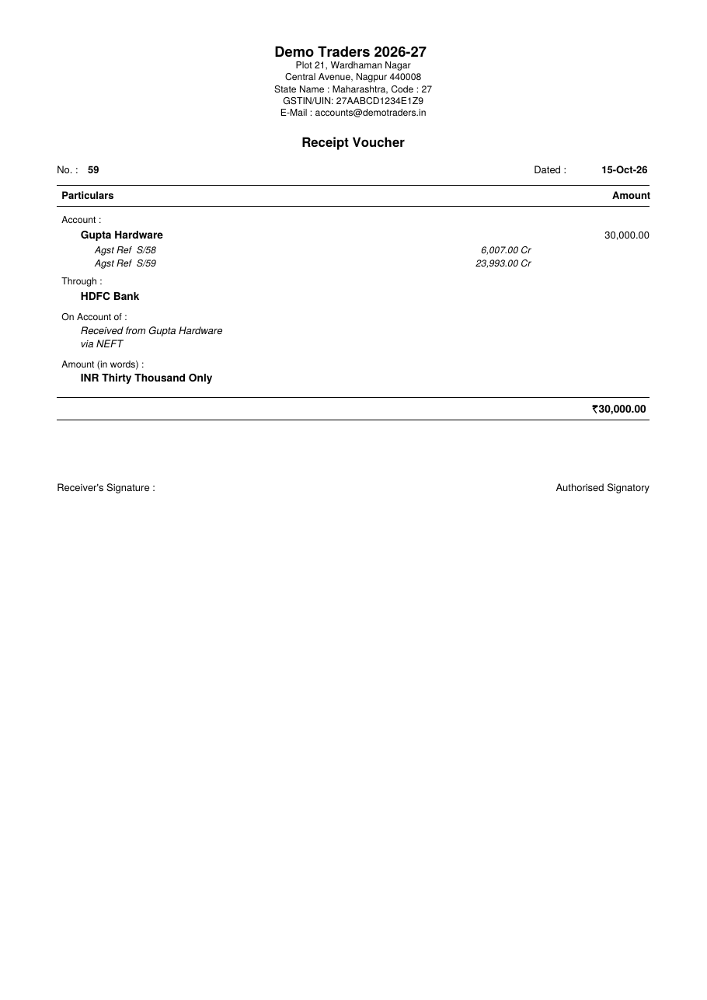</td>
</tr>
<tr><td>Sales, purchases, credit and debit notes: <b>Tax Invoice</b> with HSN, GST, amount in words, HSN tax summary, bank details and signatory</td>
<td>Receipts, payments, contra and journals: <b>Voucher</b> with Account, Through, bills settled and amount in words</td></tr></table>

## Dues

<table><tr>
<td>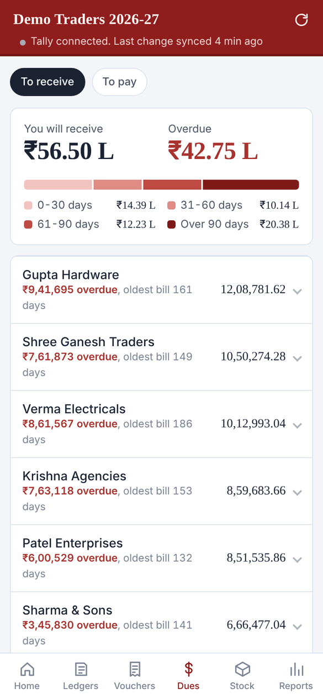</td>
<td>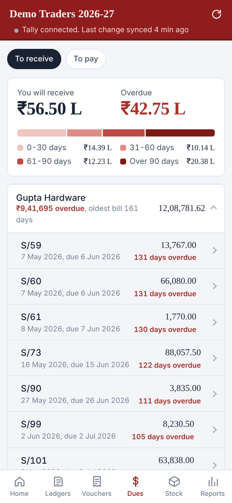</td>
</tr></table>

- Switch between **To receive** and **To pay**.
- The top shows the total, how much is **overdue**, and a bar splitting dues by age: 0-30, 31-60, 61-90 and over 90 days from the bill date.
- Each party shows its balance, overdue amount and oldest bill. **Tap a party** to see each pending bill with its date, due date and days overdue.
- **Tap a bill** to open the invoice. **Remind** sends a WhatsApp message listing the overdue bills.

Bills come from Tally's own *Bills Receivable / Bills Payable* when available. Otherwise they're worked out from the bill references in your vouchers. Any amount not linked to a bill shows as *On account*.

## Stock

Pick a period at the top. For each item you see:

- **Opening:** the quantity at the start of the period, and its value.
- **In / Out:** what came in (green) and went out (red) during the period.
- **Closing:** the quantity at the end of the period, and its value.

Stock is the **total of all your godowns**, as in Tally's own item balance: a godown showing negative because a transfer was entered late simply nets off against the others. A transfer between godowns doesn't count as stock in or out, and an invoice made against a delivery note doesn't take the stock off a second time. On an item's page these show as *moved between godowns* and *counted on the delivery note*.

Opening and closing stock, quantity and value, are **Tally's own figures** for whole months, quarters and years: the Tally PC reads each item's stock from Tally at every month-end. For a period that starts or ends in the middle of a month, Bahi starts from the nearest month-end and adds the vouchers after it, and marks the value ≈. **Excel** downloads the same table. Tap an item to see each voucher that moved it.

### Stock by godown

**Stock → Stock by godown** lists each godown with the value it holds; tap one to see its items. An item's page also shows **In each godown now**. Each godown's figure is the item's opening in that godown (from Tally) plus every voucher Bahi has that moved stock in or out of it, so a late transfer can make one godown negative for a while; it's shown in red rather than hidden. The total of all godowns is always Tally's own closing. Stock Bahi can't place in a godown (for example from vouchers older than your sync start date) shows as *Not split by godown*. Godown details arrive with the first full sync after the update.

## Reports

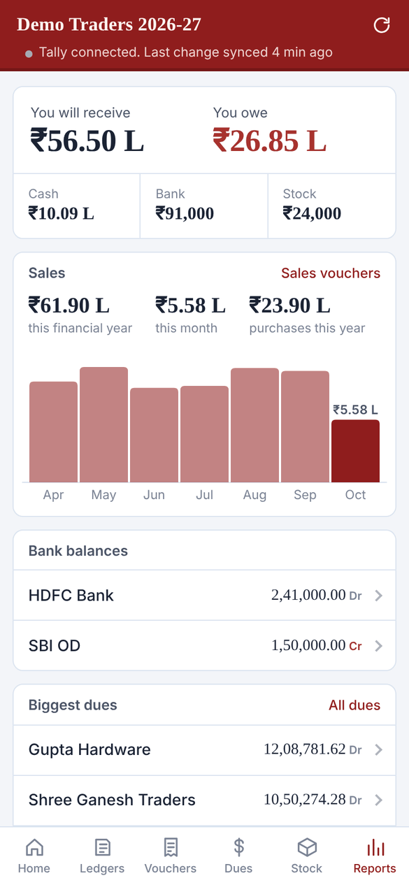

| Report | What it shows |
|---|---|
| **Vouchers** | Search and open any voucher |
| **Day Book** | All vouchers by date, filter by type |
| **Sales analysis** | Best customers and suppliers against last year, item-wise sales with margin, a month-by-month comparison with last year, and stock that hasn't sold |
| **Balance Sheet** | Liabilities and assets as on the last sync. Tap a line to open its groups and ledgers. |
| **Cash and bank book** | Money in and out each day, with opening and closing balances |
| **Follow-up list** | Who should pay you, with your notes and promised dates |
| **Profit & Loss** | Sales, purchases, stock, expenses, gross and net profit. Tap a line to see its ledgers. |
| **GST summary** | Output tax, input credit and net GST payable, month by month |
| **Group summary** | Balances by Tally group. Tap to drill down. |
| **Outstanding** | Same as Dues |
| **Stock summary** | Same as Stock |

The **Sync** box shows the synced date range, the number of ledgers and vouchers, when data last changed, and the **app version**. This screen also has buttons to switch between light and dark mode and to log out.

 

<table><tr>
<td>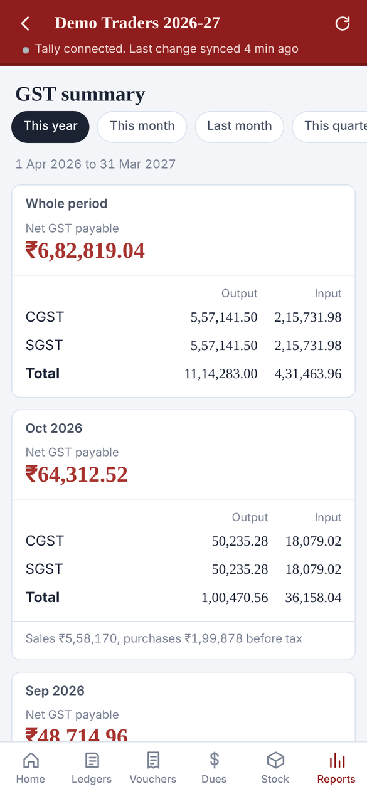</td>
<td>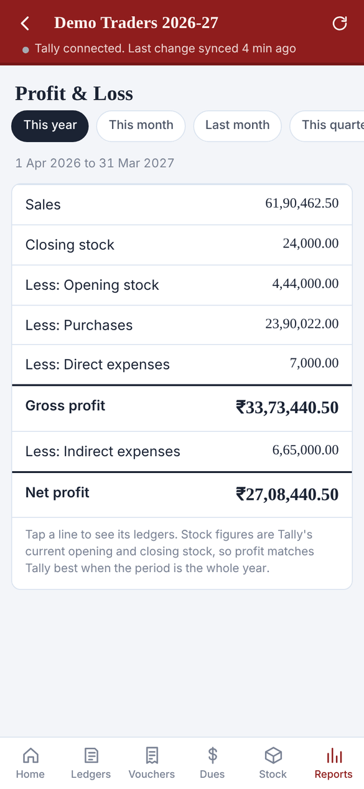</td>
<td>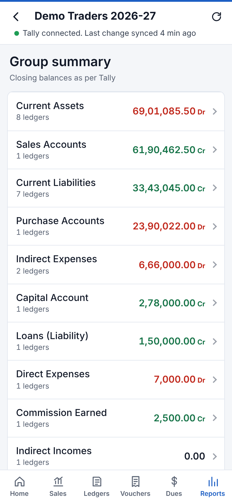</td>
<td>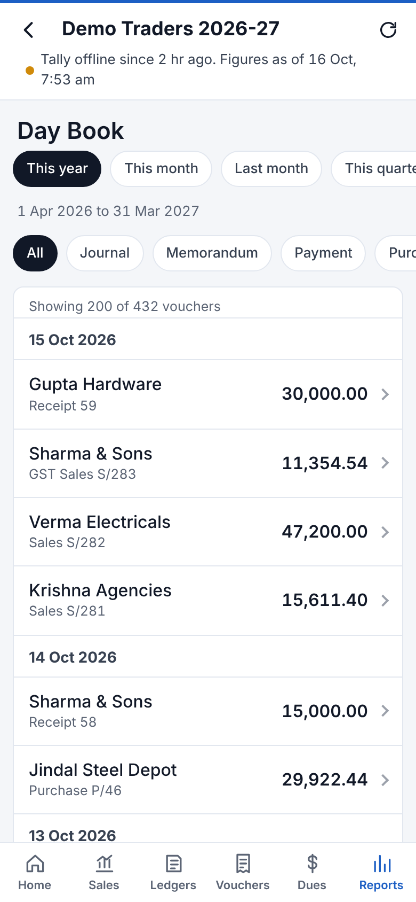</td>
</tr></table>

> **GST summary** is a quick check worked out from your vouchers. GST payments to the government and set-off entries are left out. File your returns from Tally or the GST portal.

## Balance Sheet and Profit & Loss

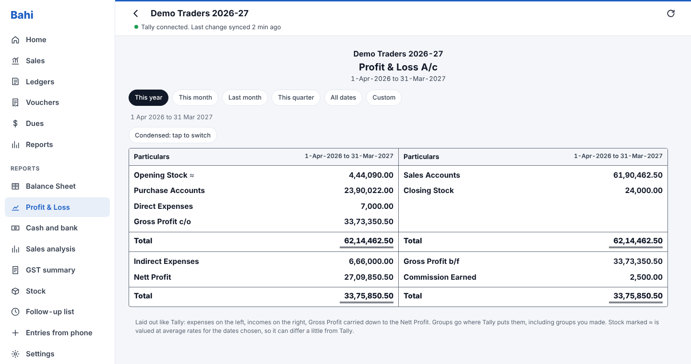

Both are laid out like Tally:

- **Profit & Loss A/c:** Opening Stock, Purchases and Direct Expenses on the left, against Sales, Direct Incomes and Closing Stock on the right, giving **Gross Profit c/o**. Below that, Gross Profit b/f and Indirect Incomes against Indirect Expenses, giving **Nett Profit**. Pick the period at the top.
- **Balance Sheet:** Liabilities on the left and Assets on the right, *as at* today, with equal totals. **Profit & Loss A/c** shows *Opening Balance* (everything up to last year) and *Current Period* (this year's Nett Profit). Closing Stock is under Current Assets.

On a computer the two sides are side by side. On a phone they are one under the other.

**Condensed / Detailed** switches between headings only and headings with their sub-groups and ledgers (in italics), like Alt+F1 in Tally. Tap any heading to open just that one. Tap a sub-group or ledger to see it.

Each group goes where Tally puts it, using the group's own settings in Tally (revenue or not, gross profit or not, debit or credit), so groups you made yourself land in the right place too.

Opening and closing stock are Tally's own figures for whole months, quarters and years. For other dates they are worked out from the nearest month-end and marked ≈.

## Cash and bank book

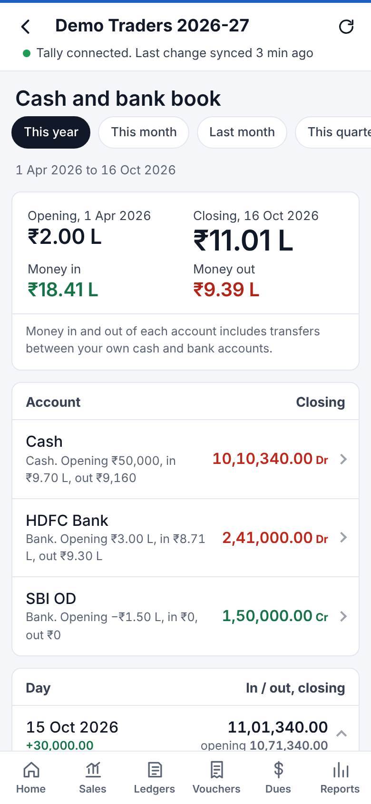

- The top shows opening and closing cash and bank for the period, and the total money in and out.
- **Account** lists each cash and bank account with its opening, money in, money out and closing balance. Tap one for its full statement.
- **Day** lists each day, newest first, with money in and out and the closing balance. Tap a day to see its entries, and tap an entry to open the voucher. Transfers between your own accounts are marked *transfer* and don't count as money in or out for the day.

 

## Bank reconciliation

**Reports → Bank reconciliation** matches your bank statement with the bank ledger in Tally.

1. In net banking, download the statement for the period as **Excel or CSV**. The `.xls` file most Indian banks give works too. A PDF statement doesn't; download Excel instead.
2. Pick the bank ledger, choose the file, and tap **Upload and match**.

Bahi pairs each statement line with a Tally entry on that ledger of the same amount and direction, up to 7 days apart (longer for an issued cheque when the cheque number appears on both sides). You then see:

- **Not in bank yet:** entries in Tally the bank hasn't shown, such as cheques issued but not presented and deposits not yet credited.
- **Not in Tally:** bank lines with no Tally entry, usually bank charges, interest and direct transfers. Enter them in Tally; after the next sync they move to Matched. If Bahi missed a pair, tap **Pair with a Tally entry**.
- **Matched:** each pair, with the day gap.

At the top is the reconciliation statement: the balance as per Tally, adjusted by the items above, gives the balance the bank should show, compared with the closing balance on the statement. Upload next month's statement to the same ledger and it adds to the earlier one; lines already there aren't counted twice.

## Follow-up list

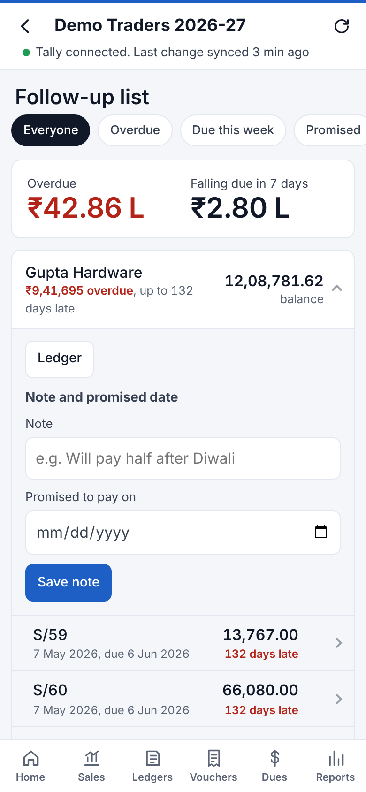

Open it from **Dues → Follow-up list** or **Reports**. It lists customers with overdue bills or bills falling due in the next 7 days, and anyone you've written a note for.

- Tap a customer to see the bills, then **Remind** on WhatsApp, **Call**, or open the ledger.
- Write a **note** ("will pay half after Diwali") and a **promised date**. On that date the customer shows under *Promised to pay today*. If the date passes and they're still overdue, they move to the top marked *promised, not paid*.
- Use the chips at the top to show only **Overdue**, **Due this week** or **Promised**.
- Bills without a credit period count as due on the bill date. Notes stay on your server; Tally isn't changed.

The Telegram morning summary also lists what falls due this week, who promised to pay today, and broken promises.

 

## Sales analysis

<table><tr>
<td>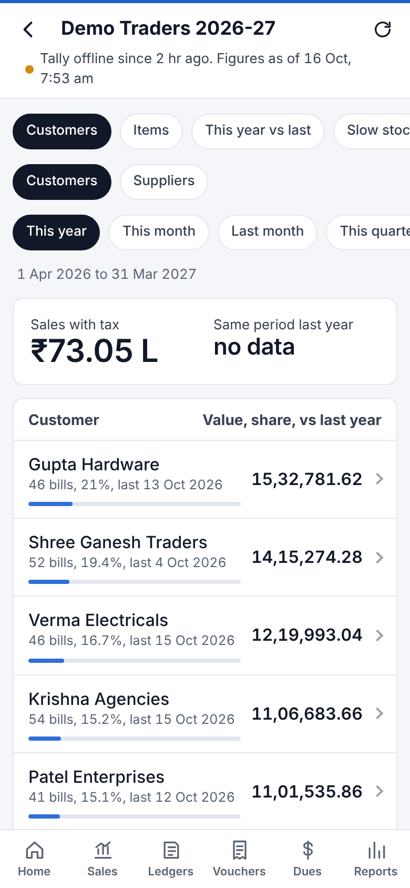</td>
<td>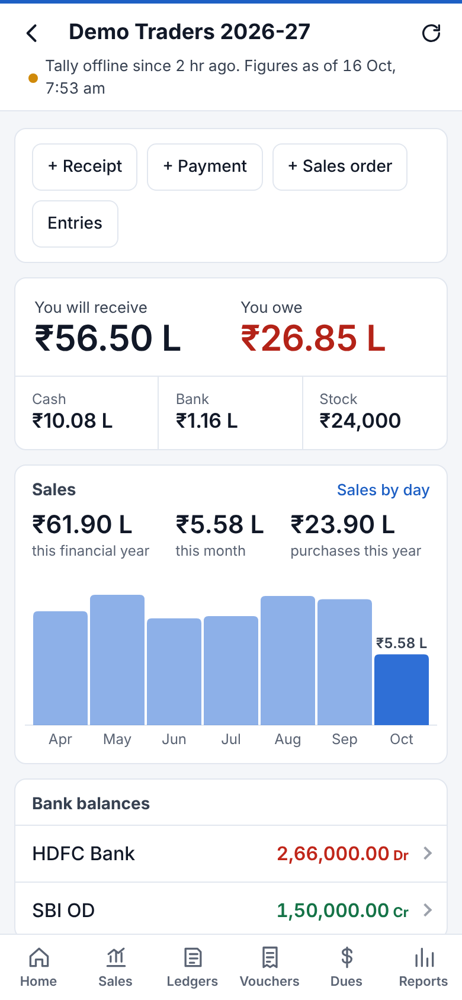</td>
</tr></table>

Open it from **Reports → Sales analysis**, or from the bottom of the **Sales** tab.

| Tab | What it shows |
|---|---|
| **Customers** | Each customer's sales in the period, their share of the total, and the change against the same period last year. Customers who bought last year but not this period are flagged. Switch to **Suppliers** for purchases. |
| **Items** | Quantity, average rate and value of each item sold, and an estimated **margin**: the average selling rate against the average purchase rate. |
| **This year vs last** | Sales before tax for each month of this financial year beside the same month last year. |
| **Slow stock** | Items in stock that haven't been sold for 30, 60, 90 or 180 days, with their value. |

Last-year comparisons need last year's vouchers on the server. If they show *not synced*, run `Setup.bat` on the Tally PC and enter an earlier **from-date**.

## Excel downloads

Ledger, Vouchers, Dues, Sales by day and every Sales analysis tab have an **Excel** button. It downloads a `.csv` file of what's on screen, which opens in Excel, Google Sheets or WPS on the phone.

## Telegram summary and alerts

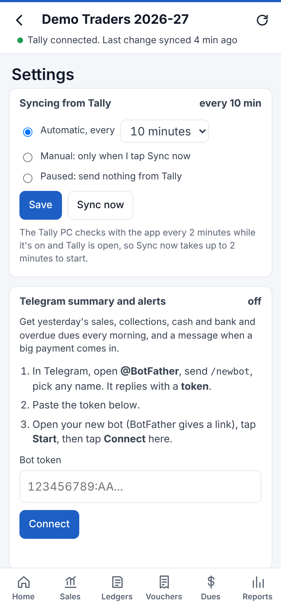

Bahi can message you on Telegram:

- **Every morning** (09:00 by default): yesterday's sales, collections and payments, sales so far this month, cash and bank, and your biggest overdue parties.
- **When a big payment comes in**: a message for every receipt above the amount you choose, soon after Tally syncs.

To set it up, in **Reports → Settings**:

1. In Telegram, open **@BotFather**, send `/newbot` and pick any name. BotFather replies with a **token**.
2. Paste the token into Bahi.
3. Open your new bot from the link BotFather gives you and tap **Start**.
4. Tap **Connect** in Bahi. You get a test message in Telegram.

After that you can change the time, the minimum amount, send a summary now, or turn it off. Only you can see your bot's messages, but don't share the token.

 

## Entering receipts, payments and orders

<table><tr>
<td>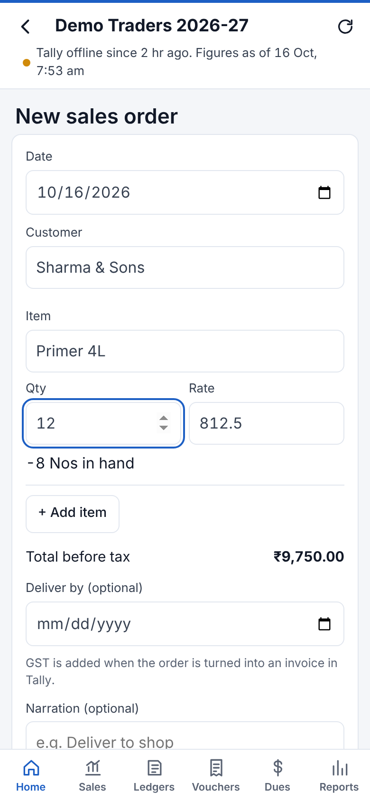</td>
<td></td>
</tr></table>

Tap **+ Receipt**, **+ Payment** or **+ Sales order** at the top of **Home**.

- **Receipt / Payment:** pick the date, the party (start typing a name), and the cash or bank account. For a customer or supplier, their pending bills appear: tick the bills this settles and the amount fills in. Anything left over goes *on account*. Add a narration such as the cheque or UTR number.
- **Sales order:** pick the customer, add items with quantity and rate (the rate starts at the item's last selling rate), and an optional delivery date. GST is added later, when you turn the order into an invoice in Tally.

The entry does **not** go into Tally straight away. Your server keeps it, and the Tally PC adds it to Tally the next time it syncs: within 10 minutes while the PC is on and Tally is open, or at once with `Sync-Now.bat`. Each one gets *(entered on phone by …)* added to its narration, so you can spot them in Tally.

**Reports → Entries from phone** shows every entry and where it is:

| Status | Meaning |
|---|---|
| Waiting for owner's approval | Made by a staff member. Approve or reject it. |
| Waiting for the Tally PC | Approved, will go in at the next sync |
| In Tally | Added. It also shows in the app as a normal voucher after that sync. |
| Tally didn't accept it | Tally's own message is shown, e.g. a ledger was renamed. Fix it in Tally and tap **Try again**, or **Cancel**. |

You can cancel an entry until it's in Tally. After that, change or delete it in Tally as usual.

## Staff logins

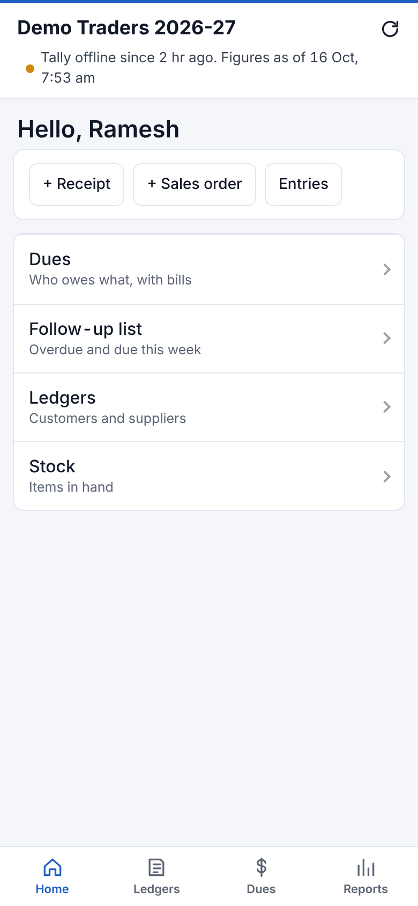

Give staff their own login so they see only what they need. In **Reports → Settings → Staff logins**, tap **Add a staff member**, set a name and password, and tick what they may see and do:

| Tick | They can |
|---|---|
| Money figures | See Home figures, Profit & Loss, Balance Sheet, cash and bank, GST and sales analysis |
| Sales by day | See daily sales |
| All ledgers / Customer and supplier ledgers only | Open ledgers. *Only customers and suppliers* hides bank, cash, expenses and capital. |
| Vouchers and Day Book | Search and open any voucher |
| Dues and follow-up list | See who owes what, send reminders, write follow-up notes |
| Stock | See stock |
| Enter receipts / payments / sales orders | Make those entries |
| No approval | Their entries go to Tally without waiting for you |

**Salesman** and **Accountant** buttons tick a sensible set for you. With two companies, you can also limit someone to one company.

Staff log in with their **name** and password. You log in as before, with the name left empty and the app password. Staff can change their own password in Settings. **Switch off** or a new password logs them out at once. Only you can see Settings for Telegram, backups, staff and deleting data.

 

## Sync: automatic, manual or paused

In **Reports → Settings → Syncing from Tally** choose:

| Setting | What happens |
|---|---|
| **Automatic, every N minutes** | The default. Pick 2, 5, 10, 15, 30 or 60 minutes. |
| **Manual** | Nothing is sent until someone taps **Sync now** (top of **Reports**, or in Settings). |
| **Paused** | Nothing is sent from Tally at all, not even with Sync now or `Sync-Now.bat`. Entries made on the phone wait until you resume. |

You can also pause one company on its own (in that company's box lower down in Settings), for example an old year you've finished with.

The Tally PC checks with the app every 2 minutes, so **Sync now** starts within 2 minutes, while the PC is on and Tally is open. The app tells you when it's done. The line under the company name shows *Manual sync* or *Sync paused* when it isn't automatic.

On the Tally PC itself, `Pause-Sync.bat` stops the automatic task completely and `Resume-Sync.bat` starts it again. `Sync-Now.bat` still works when the PC is paused this way.

### The Tally PC updates itself

When the app is updated on the server, the Tally PC picks up the new sync files on its own at its next check and carries on; there's no zip to copy any more. Settings shows the version the Tally PC runs. To control updates by hand, untick **Update the Tally PC files automatically** in Settings.

## Interest on overdue bills

Turn it on in **Reports → Settings → Interest on overdue bills** and set the rate (e.g. 18% a year) and any grace days. Bahi then works out simple interest on each overdue customer bill, from its due date (or its bill date when it has no credit period). It shows:

- on **Dues**, each **ledger** and the **Follow-up list**, per bill and per customer;
- in **WhatsApp reminders** ("Interest at 18% p.a. on the overdue bills comes to ₹… up to today");
- as a table at the end of the **ledger PDF**.

Nothing is posted in Tally. Raise an interest voucher in Tally yourself if you charge it.

## Stock alerts

On an item's page, set **Alert me on Telegram when stock falls below …**. After each sync, Telegram tells you once when an item goes below its minimum, and once when any item goes negative (all godowns together), which usually means an entry is missing. The Stock list marks these items, and **"… need attention"** at the top shows just them. The morning summary counts them too. Turn the alerts off in the Telegram settings.

## e-Invoice and e-Way Bill on invoices

When an invoice in Tally has an e-invoice (IRN) or an e-way bill, the invoice PDF prints them like Tally does: the **e-Invoice** block with IRN, Ack No., Ack Date and the signed **QR code** at the top, the **e-Way Bill No.** beside the invoice number, and the **e-Way Bill** as page 2 (number, dates, validity, distance, vehicle, addresses and goods). The voucher screen in the app lists the same details.

## Hindi in PDFs

Party names, item names, addresses and narrations written in Hindi print correctly in invoice, voucher and ledger PDFs.

## Backups

The server makes a backup every night at 02:30 and keeps the last 7. **Reports → Settings → Backups** shows when the last one ran, lets you download any of them, and has a **Back up now** button.

Each backup is a `.zip` file in the `backups` folder next to your data on Unraid (`/mnt/user/appdata/bahi/data/backups`). It holds the synced copy of your books, your follow-up notes and your settings. Your books themselves are always in Tally; the backup saves you a long re-sync and keeps your notes. See [restoring a backup](INSTALL.md#restoring-a-backup).

## Ledger statement PDF

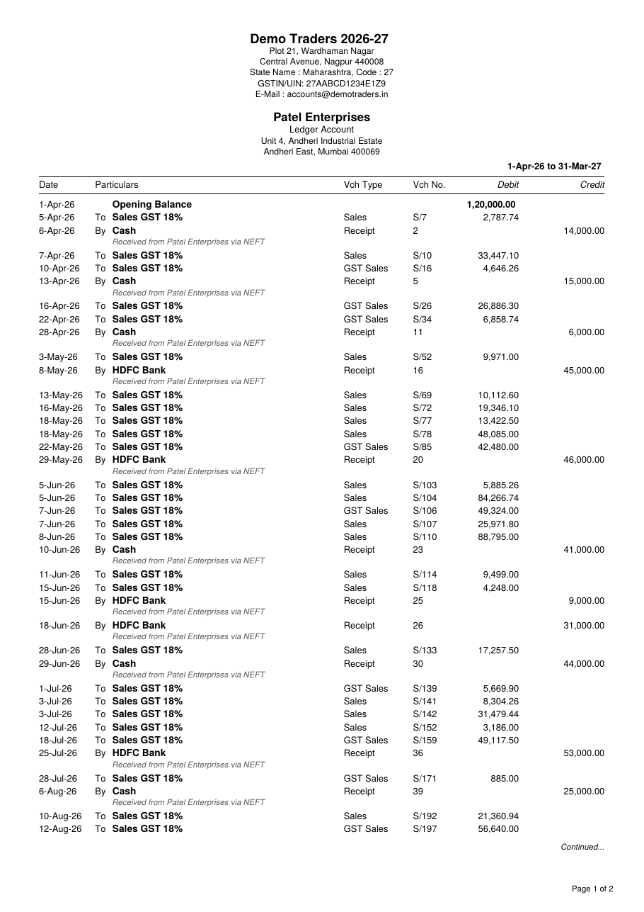

The PDF follows Tally's *Ledger Account* layout:

- your company header, then the party's name and address;
- **To** entries in the Debit column and **By** entries in the Credit column, with the narration under each entry;
- the closing balance at the end, so that both columns total the same.

## Good to know

- The Tally PC sends only the vouchers that were created, changed or deleted since the last sync, so a normal sync takes a few seconds. After a big change (more than 100 vouchers at once) it sends the affected months instead. After a server update that changes how data is stored, the next sync sends everything again.
- Figures are as of the **last sync**. If the Tally PC is off, the app shows the last copy and says so at the top.
- Without internet, the phone shows the screens you opened before, with a note saying it's a saved copy.
- PDFs print Hindi (Devanagari). Other Indian scripts such as Gujarati still print as "?". The ₹ sign prints correctly.
