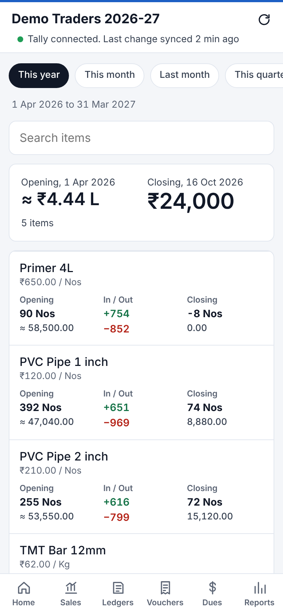
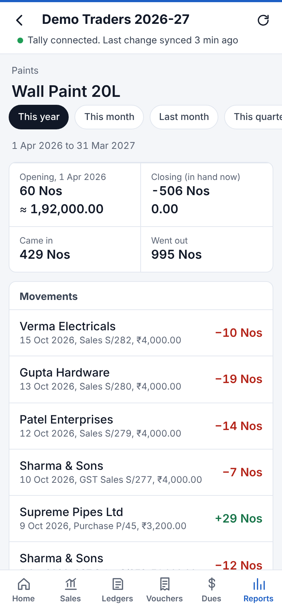
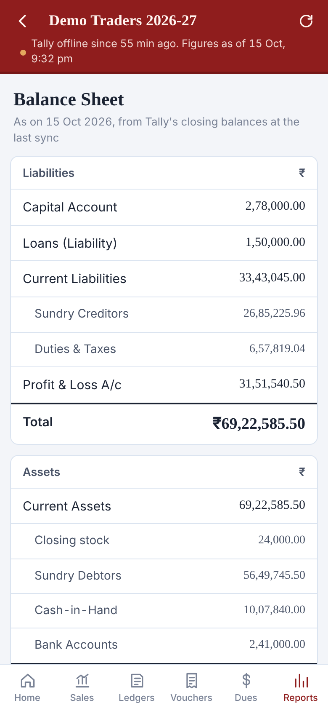

# User guide

All screenshots use made-up demo data.

The bar at the bottom has six sections: **Home, Sales, Ledgers, Vouchers, Dues and Reports**. Stock is under **Reports** and on the Home screen's Stock tile. The red bar at the top shows your company name, plus a line telling you when data was last synced and whether Tally is connected right now.

- **Tap the company name** to switch company, if you sync more than one.
- **Tap ↻** to reload the figures.
- **The period buttons** (This year, This month, Last month, This quarter, All dates, Custom) appear on most screens and decide which dates are shown. The app remembers your choice.

---

## Home

- **You will receive / You owe:** total of Sundry Debtors and Sundry Creditors. Tap either to open Dues.
- **Cash, Bank, Stock:** current balances. Tap to see the ledgers behind them.
- **Sales:** sales this financial year, this month, and purchases, with a bar for each month. Tap a bar to see the exact figure.
- **Bank balances**, **Biggest dues** and **Latest entries:** tap any row to open it.

 

## Sales by day

<table><tr>
<td></td>
<td></td>
</tr></table>

- Switch between **Sales** and **Purchases**, and pick the period.
- The top shows the total with tax and before tax, number of bills, average per day, returns (credit notes) and the best day.
- Below, every day is listed newest first, grouped by month with month totals. The red bar shows how the day compares with the busiest day.
- **Tap a day** to see that day's bills (and any returns). Tap a bill to open it.

## Ledgers

Type in the search box to find any ledger. The chips below the search box jump straight to **Debtors**, **Creditors**, **Banks** or **All groups**. **Sort** the list by name, by balance (largest first) or by most recent activity. The app remembers your choice.

 

### A party's ledger

- The top shows phone, GSTIN, and **Opening, Closing, Debits and Credits** for the selected period.
- **Share PDF** sends a Tally-style *Ledger Account* PDF, e.g. to the party on WhatsApp. **View PDF** opens it on the phone.
- **Remind** opens WhatsApp with a ready-made payment reminder. It only appears for parties who owe you and have a mobile number in Tally.
- **Pending bills** lists unpaid bills with days overdue. Tap a bill to open its invoice.
- **Sort** the statement oldest first, newest first or by largest amount.
- The statement below is laid out like a ruled account book: each entry shows the other ledger, voucher type and number, amount (Dr or Cr) and the running balance. Tap an entry to open the voucher.

The closing balance always matches Tally, because running balances are worked back from Tally's own closing figure.

 

## Vouchers

- **Search** by party name, voucher number (e.g. `S/279`), exact amount (e.g. `66080`) or a word from the narration.
- Filter by **voucher type** (Sales, Receipt, Payment and so on) and **period**. Use **All dates** to search everything synced.
- The count at the top shows how many vouchers matched. **Load more** at the bottom shows the next 200.
- **Cancelled** and **optional** vouchers are listed too, with a grey label and the amount struck through. They are never added into balances, totals or reports, just as in Tally.
- **Excel** at the bottom downloads the vouchers that matched, as a file Excel or Google Sheets opens.

 

### Opening a voucher

<table><tr>
<td></td>
<td></td>
</tr></table>

A voucher shows:

- the type, number, date and reference;
- the party and their GSTIN;
- the items with quantity and rate, plus taxable value and GST;
- every account with its Dr or Cr amount;
- bill references, such as which invoices a receipt settled (tap one to open that invoice);
- the narration.

**Share PDF** and **View PDF** produce the voucher in TallyPrime's print layout:

<table><tr>
<td></td>
<td></td>
</tr>
<tr><td>Sales, purchases, credit and debit notes: <b>Tax Invoice</b> with HSN, GST, amount in words, HSN tax summary, bank details and signatory</td>
<td>Receipts, payments, contra and journals: <b>Voucher</b> with Account, Through, bills settled and amount in words</td></tr></table>

## Dues

<table><tr>
<td></td>
<td></td>
</tr></table>

- Switch between **To receive** and **To pay**.
- The top shows the total, how much is **overdue**, and a bar splitting dues by age: 0-30, 31-60, 61-90 and over 90 days from the bill date.
- Each party shows its balance, overdue amount and oldest bill. **Tap a party** to see each pending bill with its date, due date and days overdue.
- **Tap a bill** to open the invoice. **Remind** sends a WhatsApp message listing the overdue bills.

Bills come from Tally's own *Bills Receivable / Bills Payable* when available. Otherwise they're worked out from the bill references in your vouchers. Any amount not linked to a bill shows as *On account*.

## Stock

<table><tr>
<td></td>
<td></td>
</tr></table>

The list shows every item's quantity, rate and value, with the total closing stock value at the top. Tap an item to see what came in and went out in the period, with each voucher. Tap a movement to open its voucher.

## Reports

| Report | What it shows |
|---|---|
| **Vouchers** | Search and open any voucher |
| **Day Book** | All vouchers by date, filter by type |
| **Sales analysis** | Best customers and suppliers against last year, item-wise sales with margin, a month-by-month comparison with last year, and stock that hasn't sold |
| **Balance Sheet** | Liabilities and assets as on the last sync. Tap a line to open its groups and ledgers. |
| **Cash and bank book** | Money in and out each day, with opening and closing balances |
| **Follow-up list** | Who should pay you, with your notes and promised dates |
| **Profit & Loss** | Sales, purchases, stock, expenses, gross and net profit. Tap a line to see its ledgers. |
| **GST summary** | Output tax, input credit and net GST payable, month by month |
| **Group summary** | Balances by Tally group. Tap to drill down. |
| **Outstanding** | Same as Dues |
| **Stock summary** | Same as Stock |

The **Sync** box shows the synced date range, the number of ledgers and vouchers, when data last changed, and the **app version**. This screen also has buttons to switch between light and dark mode and to log out.

 

<table><tr>
<td></td>
<td></td>
<td></td>
<td></td>
</tr></table>

> **GST summary** is a quick check worked out from your vouchers. GST payments to the government and set-off entries are left out. File your returns from Tally or the GST portal.

## Balance Sheet

Liabilities and assets from Tally's closing balances at the last sync, laid out like Tally's Balance Sheet. Tap a group to see what's in it, then tap again to open the group or ledger. Closing stock is shown under Current Assets.

**Profit & Loss A/c** is last year's balance from Tally plus this year's profit, worked out so that both sides match. If it doesn't agree with Tally, the usual reason is a difference in opening balances, or vouchers that didn't add up (see **Sync check**).

 

## Cash and bank book

- The top shows opening and closing cash and bank for the period, and the total money in and out.
- **Account** lists each cash and bank account with its opening, money in, money out and closing balance. Tap one for its full statement.
- **Day** lists each day, newest first, with money in and out and the closing balance. Tap a day to see its entries, and tap an entry to open the voucher. Transfers between your own accounts are marked *transfer* and don't count as money in or out for the day.

 

## Follow-up list

Open it from **Dues → Follow-up list** or **Reports**. It lists customers with overdue bills or bills falling due in the next 7 days, and anyone you've written a note for.

- Tap a customer to see the bills, then **Remind** on WhatsApp, **Call**, or open the ledger.
- Write a **note** ("will pay half after Diwali") and a **promised date**. On that date the customer shows under *Promised to pay today*. If the date passes and they're still overdue, they move to the top marked *promised, not paid*.
- Use the chips at the top to show only **Overdue**, **Due this week** or **Promised**.
- Bills without a credit period count as due on the bill date. Notes stay on your server; Tally isn't changed.

The Telegram morning summary also lists what falls due this week, who promised to pay today, and broken promises.

 

## Sales analysis

<table><tr>
<td></td>
<td></td>
</tr></table>

Open it from **Reports → Sales analysis**, or from the bottom of the **Sales** tab.

| Tab | What it shows |
|---|---|
| **Customers** | Each customer's sales in the period, their share of the total, and the change against the same period last year. Customers who bought last year but not this period are flagged. Switch to **Suppliers** for purchases. |
| **Items** | Quantity, average rate and value of each item sold, and an estimated **margin**: the average selling rate against the average purchase rate. |
| **This year vs last** | Sales before tax for each month of this financial year beside the same month last year. |
| **Slow stock** | Items in stock that haven't been sold for 30, 60, 90 or 180 days, with their value. |

Last-year comparisons need last year's vouchers on the server. If they show *not synced*, run `Setup.bat` on the Tally PC and enter an earlier **from-date**.

## Excel downloads

Ledger, Vouchers, Dues, Sales by day and every Sales analysis tab have an **Excel** button. It downloads a `.csv` file of what's on screen, which opens in Excel, Google Sheets or WPS on the phone.

## Telegram summary and alerts

Bahi can message you on Telegram:

- **Every morning** (09:00 by default): yesterday's sales, collections and payments, sales so far this month, cash and bank, and your biggest overdue parties.
- **When a big payment comes in**: a message for every receipt above the amount you choose, soon after Tally syncs.

To set it up, in **Reports → Settings**:

1. In Telegram, open **@BotFather**, send `/newbot` and pick any name. BotFather replies with a **token**.
2. Paste the token into Bahi.
3. Open your new bot from the link BotFather gives you and tap **Start**.
4. Tap **Connect** in Bahi. You get a test message in Telegram.

After that you can change the time, the minimum amount, send a summary now, or turn it off. Only you can see your bot's messages, but don't share the token.

 

## Backups

The server makes a backup every night at 02:30 and keeps the last 7. **Reports → Settings → Backups** shows when the last one ran, lets you download any of them, and has a **Back up now** button.

Each backup is a `.zip` file in the `backups` folder next to your data on Unraid (`/mnt/user/appdata/bahi/data/backups`). It holds the synced copy of your books, your follow-up notes and your settings. Your books themselves are always in Tally; the backup saves you a long re-sync and keeps your notes. See [restoring a backup](INSTALL.md#restoring-a-backup).

## Ledger statement PDF

The PDF follows Tally's *Ledger Account* layout:

- your company header, then the party's name and address;
- **To** entries in the Debit column and **By** entries in the Credit column, with the narration under each entry;
- the closing balance at the end, so that both columns total the same.

## Good to know

- The Tally PC sends only the months that changed, so a normal sync takes a few seconds. After a server update that changes how data is stored, the next sync sends everything again.
- Figures are as of the **last sync**. If the Tally PC is off, the app shows the last copy and says so at the top.
- Without internet, the phone shows the screens you opened before, with a note saying it's a saved copy.
- PDFs use a standard font, so names written in Hindi or other Indian scripts print as "?". The ₹ sign prints correctly.
